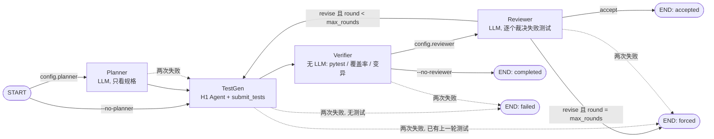

# Design：Kytest-Agents 多 Agent 测试生成工作流

Homework 2 在 Homework 1 的单 Agent（Kytest-Agent，设计见 [docs/h1-design.md](docs/h1-design.md)）之上，
把“理解规格 → 写测试 → 执行验证 → 复核裁决”拆给四个节点协作完成，并为整个 MAS 设计了新基准。
范围与取舍记录在 [docs/SCOPE.md](docs/SCOPE.md)。

## 1. 出发点：测试的预期值从哪来

一个测试 = 输入 + 预期值 + 执行比较。执行比较是机械的，难点在预期值。预期值如果是读实现、跑实现得到的，
测试只是在复述实现：实现有 bug，测试就把 bug 写成“正确”，而且照样通过。H1 的 `submit_tests`
只保留在被测实现上通过的测试，于是在有 bug 的实现上，**正确的测试反而被丢弃**。

因此本设计的核心是**信息隔离**和**裁决权分离**：

- Planner 只看规格（签名 + docstring），看不到函数体，计划中的预期值无法从实现抄来；
- TestGen 按计划写测试，在实现上失败的测试不再丢弃，而是交给 Reviewer；
- Reviewer 依据规格裁决每个失败是“测试错”还是“疑似实现缺陷”，后者单独输出为缺陷报告。

## 2. 流程



实线是 `mas/nodes.py` 末尾的 `TRANSITIONS`，虚线是 `ON_ERROR`。控制流只在这两张表里；节点代码不决定下一步去哪。

- **顺序**：Planner → TestGen → Verifier → Reviewer。
- **循环**：Reviewer 判 `revise` 时带着修订意见回到 TestGen，最多 `--rounds`（默认 2）轮。
- **条件分支**：`accept` / 达到轮数上限 / 消融开关 / 错误恢复。
- **错误处理与恢复**：每个节点失败自动重试一次（`ATTEMPTS_PER_NODE = 2`），仍失败则走 `ON_ERROR`
  降级路径并记入 `state["degraded"]`；每个节点结束后写检查点，`--resume runs/<id>` 从中断处继续。

## 3. 节点职责

| 节点 | LLM | 能看到 | 产出（写入共享状态） |
|---|---|---|---|
| Planner | 是 | `extract_spec()` 的结果：import、签名、docstring；函数体被替换为 `...` | `plan`：6–12 条编号条目（类别、输入、预期、依据、置信度）+ `ambiguities` |
| TestGen | 是（H1 A4 Agent） | 完整源码 + 计划 + 上一轮 Reviewer 意见 | `test_solution.py`（在实现上通过）；`testgen[].failed`（失败候选的代码与诊断） |
| Verifier | 否 | 工作区 | `verification[]`：pytest 结果、行覆盖率、未覆盖行、8 个开发用变异体的存活情况、计划条目引用率 |
| Reviewer | 是 | 规格、实现、计划、失败测试及诊断、Verifier 报告 | `reviews[]`：每个失败测试的 `test_wrong` / `suspected_bug` 裁决与理由，`accept` / `revise` 与指令；`suspected_bugs` |

Planner 和 Reviewer 的提示词里写明了两条规则（来自开发集调试，见第 7 节）：
前置条件只是限制调用者，不是“会抛异常”的承诺，违反前置条件的输入属于未定义行为；
Reviewer 不能要求修改实现，也不能要求测试规格没有规定的行为。

## 4. Agent 间通信：共享状态与交接约定

所有节点读写同一个 `state`（`mas/engine.py:new_state`），签名统一为 `node(state, ctx) -> 更新字典`，
由引擎合并并持久化。节点之间的交接靠可机械检查的约定，而不是自由文本：

| 交接 | 约定 | 谁检查 |
|---|---|---|
| Planner → TestGen | 计划条目编号 `P1…Pn` | TestGen 测试名必须为 `test_p<N>_…`（计划外的为 `test_extra_…`） |
| TestGen → Verifier | 测试名中的编号 | Verifier 计算 `plan_coverage`：哪些条目被引用、哪些缺失 |
| TestGen → Reviewer | 失败候选的代码、预期值依据、失败诊断 | Reviewer 必须对**每个**失败测试给出裁决，否则重新请求（`_check_review`） |
| Reviewer → TestGen | `instructions` 列表 | 下一轮 TestGen 提示词原样附上；已接受测试不可改名覆盖 |
| Reviewer → 输出 | `suspected_bug` 的测试 | 写入 `test_suspected_bugs.py` 与 `bug_report.md`，并关联计划条目 |

LLM 返回的 JSON 由 `json_call` 解析与校验，格式不合格时把错误回传给模型重试，仍不合格则该节点失败并进入恢复路径。

运行目录 `runs/<id>/`：

```
state.json               完整共享状态（每个节点后原子写入，恢复点）
log.jsonl                每个事件一行：节点开始/结束/耗时、LLM 回复、Agent 工具调用、错误、恢复
workspace/solution.py    被测模块（Agent 唯一能看到的文件）
test_solution.py         最终接受的测试
plan.json  test_suspected_bugs.py  bug_report.md
```

## 5. 可扩展性：新增一个节点

新增节点不需要改其他节点。以一个“Linter”节点为例（在 TestGen 之后检查测试风格）：

```python
# mas/nodes.py
def linter(state, ctx):
    tests = (Path(state["workspace"]) / TESTS).read_text(encoding="utf-8")
    issues = [n for n in test_names(tests) if not PLAN_REF.match(n) and not n.startswith("test_extra_")]
    return {"lint": issues}

NODES["linter"] = linter
TRANSITIONS["testgen"] = lambda s: "linter"
TRANSITIONS["linter"] = lambda s: "verifier"
ON_ERROR["linter"] = lambda s: "verifier"   # 风格检查失败不阻断流程
```

`new_state` 里给 `lint` 一个初始值即可。同理，消融开关就是 `start` / `after_verifier` 读取
`state["config"]` 做的分支；“换一个模型给某个角色”只需改 `Context.role_llm(role)`。

## 6. 对 H1 资产的改动

| 改动 | 原因 |
|---|---|
| `testgen.py` 保留在实现上失败的候选（代码 + 诊断），不进入模型反馈 | Reviewer 需要裁决它们；H1 直接丢弃 |
| 契约引用可来自任意 docstring（模块、类、方法） | 基准包含有状态类（ClassEval） |
| 静态检查与运行时守卫识别类构造与实例方法调用；只包装方法，不包装类 | 否则类测试全被判为“没有调用被测对象”；不包装类以保留 `isinstance` |

全套工程测试（含 H1 原有测试）通过；新增测试覆盖工作流分支（`tests/test_mas.py`）、类目标（`tests/test_testgen.py`）
与基准评分（`tests/test_bench.py`）。

## 7. 基准：为什么要新的，以及它测什么

H1 的基准（MBPP 20 题、单函数、算子替换故障）针对单 Agent 设计，测不出这个 MAS 的价值：
被测实现都是正确的，从实现抄预期值也不会错；故障浅；接近饱和。新基准在 `bench/`：

**题目（14 题，5 开发 / 9 冻结测试）**

| 来源 | 题 | 层 |
|---|---|---|
| QuixBugs（MIT） | `to_base` `kth` `lis` `get_factors` `shunting_yard` `find_first_in_sorted` | T2 算法函数，自带人写缺陷 |
| ClassEval（代码 MIT，数据 CC-BY-NC） | `ShoppingCart` `BankAccount` `Warehouse` | T3 有状态类 |
| ClassEval | `VendingMachine` | T5 规格自相矛盾（docstring 说返回 list，示例与实现返回 str） |
| BigCodeBench-Hard（Apache-2.0） | `factorial_sums`(854)；`bigram_counts`(928) | T2 规格丰富的函数；928 为 T5（docstring 说用 `itertools.permutations` 生成 650 个键，又说“所有两字母组合”676 个） |
| 原创 | `allocate`（最大余数分配） | 未公开对照：排除预训练见过的影响 |
| 原创 | `normalize_tags` | T5 有意留白（内部空白、Unicode 大小写未规定） |

每题有只给评测器看的隐藏资产：

- **金标准测试**：上游测试；上游测试杀不死某个缺陷时，按 docstring 补 `gold_extra_test.py`（4 题需要补，说明上游测试本身没覆盖规格）。
- **缺陷变体**（38 个）：QuixBugs 上游人写缺陷 + 手写合成缺陷，`meta.json` 标注来源。
  每个缺陷都对照 docstring 审核过：只有规格（文字或示例）明确规定了被破坏的行为，才算 `spec_decided`，
  才计入检出率、才能当主缺陷。6 个缺陷未通过审核（如“下单是否扣库存”docstring 从未说明），
  标为 `spec_decided: false` 并写明原因，只计入辅助指标 `kill_rate_all`。
  这次审核是在开发集上发现 `bigram_counts` 的主缺陷其实可由规格推出之后做的，覆盖全部 14 题，在测试集运行之前完成。
- **合法替代实现**（15 个）：只在规格未规定处与参考实现不同（前置条件外的输入、未规定的顺序或返回值、错误信息）。现有公开基准都没有这一项，全部自写。

`bench/validate.py` 机械校验：金标准在参考实现和每个替代实现上通过、在每个缺陷上失败、每个变体确实与参考不同。

**两种条件 × 四种配置**

- `clean`：被测对象是正确参考实现。测：测试数、**缺陷检出率**（套件在多少缺陷变体上失败）、
  **误报率**（套件在多少合法替代实现上失败 = 过度约束）、错误缺陷报告数。
- `buggy`：被测对象换成该题的主缺陷，模拟“实现有 bug 时写测试”。测：**是否报告出缺陷**
  （有疑似缺陷测试在参考实现上通过、在缺陷版上失败）、错误报告数、**固化**（接受的测试在参考实现上失败，即 bug 被写进了预期值）。
- 配置：`mas`（完整）、`no_planner`、`no_reviewer`、`single`（两者都去掉，≈ H1 A4 的单 Agent）。

所有指标都由 `bench/score.py` 执行产出的测试得到，不采信任何 Agent 的自我报告。
提示词只在开发集上调整；测试集在冻结提示词后才运行。

## 8. 结果

见 [docs/evaluation-h2.md](docs/evaluation-h2.md)。

## 9. 局限

- 每个配置每题只跑 1 次，样本小，只做描述性报告与区间，不声称显著。
- 合成缺陷与替代实现由同一作者编写，可能偏向作者能想到的错误类型。
- 同一个模型（qwen3.7-flash）担任所有角色；角色独立性来自信息隔离，不来自模型差异。
- `single` 配置复用了本工作流的 TestGen 提示词，不完全等同于 H1 的 A4 实验条件。
- Reviewer 看得到实现；它的裁决依据规格是提示词要求，不是强制隔离。
