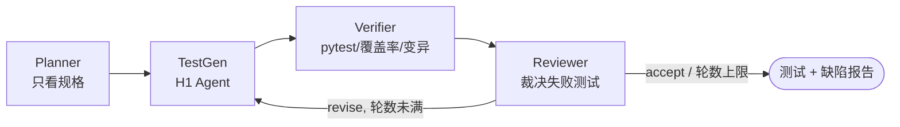
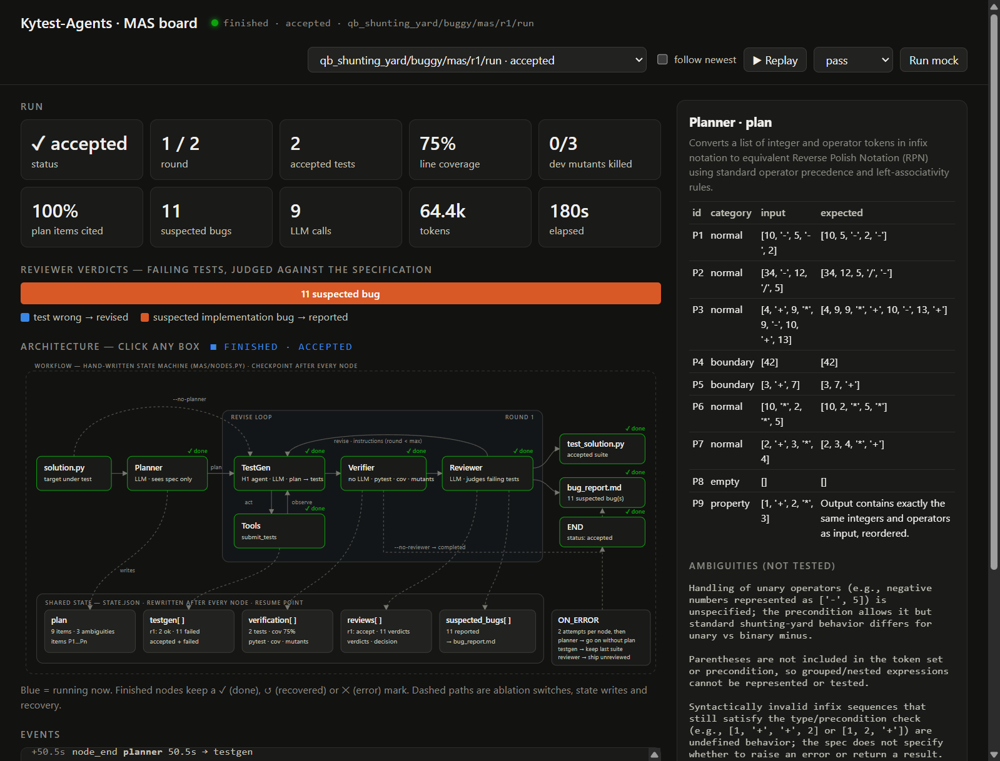

# Kytest-Agents：多 Agent 测试生成工作流

*Planner → TestGen → Verifier → Reviewer：先从规格推出该测什么，再写测试、执行验证、裁决失败。*

Homework 2。在 Homework 1 的单 Agent [Kytest-Agent](https://github.com/kyrie21z/Kytest-Agent) 之上做增量：
H1 的 Agent 作为 TestGen 节点复用，新增 Planner、Verifier、Reviewer 三个节点，用自己写的状态机编排（不依赖 LangGraph 等框架），
并配套一个面向整个 MAS 的新基准。

[演示视频（48 秒）](docs/demo-h2.mp4) · [Design](Design.md) · [评测结果](docs/evaluation-h2.md) · [范围](docs/SCOPE.md) · [H1 设计](docs/h1-design.md)

## 解决什么问题

单 Agent 读完实现再写断言，预期值容易直接抄实现。实现有 bug 时，测试把 bug 固化成“正确”，照样全部通过。
本工作流让 **Planner 只看签名和 docstring** 来规划用例和预期值；TestGen 按计划写测试；
在实现上失败的测试不再丢弃，而是由 **Reviewer 依据规格裁决**是测试写错了，还是实现有疑似缺陷。



完整流程图（含消融分支和错误恢复路径）、节点输入输出、共享状态与扩展方式见 [Design.md](Design.md)。

**结果（9 题冻结测试集，144 次运行）：** 被测代码有 bug 时，完整工作流 16/18 次报告出缺陷、0/18 次把 bug 写进测试；
接近 H1 的单 Agent 0/18 报告、10/18 把 bug 写进了预期值。被测代码正确时两者的缺陷检出率相近，代价约为单 Agent 的 2 倍。
详见 [docs/evaluation-h2.md](docs/evaluation-h2.md)。

## 快速开始

需要 Linux（Ubuntu / WSL）、Python ≥ 3.9 和 Bubblewrap（H1 的命令沙箱）。

```bash
sudo apt-get install python3-venv bubblewrap
git clone https://github.com/kyrie21z/kytest-Agents.git && cd kytest-Agents
python3 -m venv .venv && source .venv/bin/activate
pip install -r requirements.txt -e .
```

**离线演示（无需 API Key）。** 脚本只替换模型回复，测试执行、覆盖率、变异、状态和日志都是真实的，每个场景走一条分支：

```bash
python kytest.py --mock pass       # 计划 → 测试通过 → Reviewer 接受
python kytest.py --mock revise     # 一个测试写错 → test_wrong → 修订一轮 → 接受
python kytest.py --mock bug        # 被测代码有差一错误 → 按计划写的测试失败 → suspected_bug + bug_report.md
python kytest.py --mock stubborn   # Reviewer 始终不接受 → 达到轮数上限 → forced
python kytest.py --mock flaky      # Planner 模型持续出错 → 自动降级为无计划继续
```

每次运行输出路径与摘要，产物在 `runs/<id>/`：`state.json`、`log.jsonl`、`plan.json`、`test_solution.py`，
发现缺陷时还有 `test_suspected_bugs.py` 和 `bug_report.md`。

**实时架构看板。** 在另一个终端启动看板，再运行任意一次工作流，正在执行的 Agent 会在架构图上点亮：

```bash
python board.py                                   # 打开 http://127.0.0.1:8770
python board.py --runs docs/evidence --port 8771   # 回放已保存的 186 次真实模型运行（含基准与演示）
```

回放不需要模型或网络：在下拉框里选一次运行（如 `buggy-classify-mas`，演示视频里那次规格裁决报告植入 bug 的完整工作流），点“Replay”即按记录的事件顺序重新点亮各节点。
看板只读取引擎本来就会写的 `state.json` 与 `log.jsonl`：节点运行时显示蓝色，结束后标 ✓ 完成、↺ 已恢复或 ✕ 出错；
连线随状态转移流动，节点写入共享状态时对应格子闪烁。页面上的“Run mock”按钮可以直接启动离线场景，“Replay”按钮可以重放已完成的运行；点击任意方框会显示该节点的计划、裁决、验证报告或工具调用。



[演示视频](docs/demo-h2.mp4)（48 秒）：一次真实模型运行在看板上逐个点亮各 Agent（5.9 倍速），Reviewer 依据规格报告植入的边界 bug；
离线 `revise` 场景展示修订回路（1.5 倍速）；最后是测试集的关键结果。

**真实模型。** 复制 `.env.example` 为 `.env`，填写 OpenAI 兼容接口的 `LLM_API_KEY`、`LLM_BASE_URL`、`LLM_MODEL`
（本项目使用百炼 `qwen3.7-flash`），然后：

```bash
python kytest.py mas/demo/classify_buggy.py              # 完整工作流
python kytest.py mas/demo/classify_buggy.py --no-planner --no-reviewer   # 接近 H1 的单 Agent
python kytest.py --resume runs/<id>                      # 从检查点继续中断的运行
```

**OpenRouter。** 任何 OpenAI 兼容服务都可以用一个单独的配置文件切换，不必改 `.env`。密钥可以放在仓库之外，用 `LLM_API_KEY_FILE` 指向：

```bash
cp .env.openrouter.example .env.openrouter     # 默认 nvidia/nemotron-3-ultra-550b-a55b:free，密钥读 ~/.config/openrouter/api_key
python kytest.py mas/demo/classify_buggy.py --env .env.openrouter
python bench/run.py --name or1 --split dev --jobs 1 --env .env.openrouter
```

Nemotron 是推理模型，示例配置把 `LLM_MAX_TOKENS` 调到 16384；若推理用完输出上限而没有正文，客户端会报错提示调大。免费模型有每日请求上限（未充值账户 50 次/天，一次完整工作流约 10–15 次请求）。

`mas/demo/classify_buggy.py` 植入了一个边界 bug：完整工作流报告出缺陷，单 Agent 把 bug 写进了预期值。
两次运行的记录保存在 [docs/evidence/](docs/evidence/)。

## 基准

```bash
python bench/validate.py                                   # 校验隐藏资产（不需要模型）
python bench/run.py --name test1 --split test --jobs 6     # 4 种配置 × 干净/有 bug 两种被测对象
python bench/score.py --name test1                         # 执行产出的测试，写 summary.md
```

14 题来自 QuixBugs、ClassEval、BigCodeBench-Hard 与 2 道原创题，每题带隐藏的缺陷变体和**合法替代实现**，
用来分别测量“检出缺陷”和“过度约束误报”。设计见 [Design.md §7](Design.md#7-基准为什么要新的以及它测什么)，
结果见 [docs/evaluation-h2.md](docs/evaluation-h2.md)，来源与许可证见[第三方材料说明](docs/third-party.md)。

## 工程测试

```bash
python -m pytest tests/ -q
```

包括 H1 原有测试、工作流各分支（`tests/test_mas.py`）与基准评分（`tests/test_bench.py`），不需要 API Key。

## 与 Homework 1 的关系

H1 的单 Agent CLI 与 Web 界面仍然可用：`python main.py --help`、`python web.py`，说明见 [docs/demo.md](docs/demo.md)，
设计见 [docs/h1-design.md](docs/h1-design.md)，H1 评价见 [docs/evaluation.md](docs/evaluation.md)，沙箱边界见 [docs/security.md](docs/security.md)。
本仓库从 Kytest-Agent 复制而来并保留了完整提交历史；对 H1 代码的改动列在 [Design.md §6](Design.md#6-对-h1-资产的改动)。

## 许可证

原创代码 [Apache-2.0](LICENSE)。基准中 ClassEval 数据为 CC-BY-NC-4.0（仅非商业用途），其余来源见 [docs/third-party.md](docs/third-party.md)。
